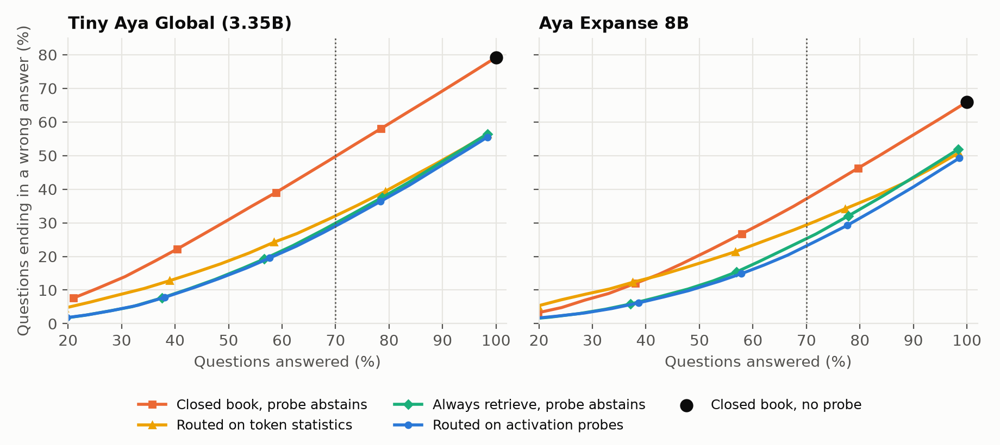

# KnowWhen-R

Activation probes that help a frozen language model decide whether to answer from memory, use retrieved passages, or abstain. Built for the Lexsi AI Safety and Alignment Hackathon 2026, Track 2b, problem statement 13.

The full report is [reports/report.pdf](reports/report.pdf), with the same text in [reports/report.md](reports/report.md), and the abstract is in [reports/abstract.md](reports/abstract.md).

| | Link |
|---|---|
| Demo (replay of recorded test runs) | https://huggingface.co/spaces/kungfupanda12/knowwhen-r-demo |
| Probes (model repository) | https://huggingface.co/kungfupanda12/knowwhen-r-probes |
| Traces, results and logs (dataset repository) | https://huggingface.co/datasets/kungfupanda12/knowwhen-r-traces |
| Model collection | https://huggingface.co/collections/kungfupanda12/knowwhen-r-models-6af04f595e2e4ff623aeb1a4 |
| Dataset collection | https://huggingface.co/collections/kungfupanda12/knowwhen-r-datasets-6af04f5af9fc0e4ee40ba053 |

## The result

On 3,968 test questions from NQ, TriviaQA, HotpotQA and PopQA, with every system answering exactly 70% of questions:

| Wrong answers, % of all questions | Tiny Aya Global | Aya Expanse 8B |
|---|---|---|
| Answer everything from memory (100% answered) | 79.2 | 65.8 |
| Closed book probe abstains | 49.7 | 37.1 |
| Always retrieve, probe abstains | 29.9 | 25.2 |
| KnowWhen-R routing | **29.0** | **23.1** |



The most useful finding is about where activations help. For closed book answers on unseen datasets, a simple model on token statistics often does just as well. After retrieval, activation probes clearly beat it on the 8B model (0.877 against 0.724 macro AUROC in domain) and on Tiny Aya (0.868 against 0.782), probably because a model can be confident about something it copied from a passage.

Please also read the limits. Most of the gain comes from retrieval plus the probe on the retrieved answer. Routing adds only 1 to 3 points over always retrieving in domain, and almost nothing on unseen datasets, though it makes 15 to 28% fewer retrieval calls. A fixed cut drifts on a new dataset, so the answer cut should be set from the last 100 questions, which `scripts/online_cut.py` shows keeps coverage within about 2 points of target. HotpotQA is weak, and about a third or more of the answers given are still wrong. Outside English we tested only closed book answers: on the same 600 MKQA questions in Spanish, German, French, Russian and Turkish, the English trained probe kept its AUROC within 0.035 of English with no retraining.

## How it works

Three linear probes read the model's hidden states. One judges the closed book answer, one forecasts how a retrieved answer would do, and one judges the retrieved answer. A question goes to the likelier path, and answers below a confidence cut are withheld. The probes are L2 logistic regression with temperature scaling, because neither an MLP nor richer features did better on development data.

| Toolkit | Used for |
|---|---|
| CuratorKIT | Exact and MinHash deduplication across datasets, keeping test copies |
| SafeTune | `LinearProbeGuardModel` runs the prompt only probe live and sends flagged prompts to retrieval |
| AuditKIT | Independent replay of every policy's answers with a separate scorer |
| CircuitKIT | Attempted, ran out of GPU memory four times, no results claimed |

## Layout

`src/knowwhen` holds the package, `scripts` the pipeline, `tests` the unit tests, `results` every table, `reports` the write up and figures, `demo` the replay app, `experiments` run scripts and logs, and `docs` the analysis plan, experiment registry and notes. Start with `docs/analysis_plan.md` and `docs/experiment_registry.md` if you want to see what was decided when, including failed runs.

## Reproducing the results

Python 3.12. The Cohere models are gated with automatic approval, so accept their terms and run `hf auth login` first. The Lexsi toolkits are installed from their own repositories and are not included here. SafeTune is used from source, by adding its `src` folder to `PYTHONPATH`.

```bash
pip install -r requirements.txt && pip install -e .
# On a Mac with an external drive: copy env.example.sh to env.sh, set its paths, then
source env.sh
# Anywhere else, point the code at your own folders. See src/knowwhen/paths.py
export KW_REMOTE=1 KW_ROOT=$PWD KW_ENV=/path/to/large/storage

# Data and retrieval
python scripts/prepare_data.py
python scripts/finalize_splits.py
python scripts/build_wiki_index.py
python scripts/retrieve_all.py
python scripts/rerank_all.py

# Generation, about 7.5 hours on a Kaggle T4 pair. See docs/kaggle_run.md
python scripts/kaggle_run.py --model CohereLabs/tiny-aya-global --conditions closed --tag t4
python scripts/kaggle_run.py --model CohereLabs/tiny-aya-global --conditions rag --retrieved retrieved_reranked.jsonl --tag t4-rerank --checks
# then the same two lines with --model CohereLabs/aya-expanse-8b

# Analysis and tables, about 6 hours on a MacBook Air M2
experiments/run_final.sh
python scripts/summarize_final.py
python scripts/matched_unseen.py --tag t4_rerank
python scripts/matched_unseen.py --tag aya8b_rerank
python scripts/stability_check.py --tag t4_rerank
python scripts/popqa_popularity.py --tag t4_rerank
python scripts/make_figures.py

pytest
```

To skip generation, download the traces from the dataset repository into `artifacts/runs`. Activations are large and are not published, so probe fitting needs a generation run. The fitted probes are in the model repository and need nothing but NumPy to score a hidden state. Splits use seed 13 and bootstraps use 2,000 resamples. The probe seeds in the scripts change nothing, because the fit is deterministic.

## Demo

The public demo is a static page in `demo_static/`, hosted as a Hugging Face Space. It replays the recorded test runs in the browser, so it needs no GPU and generates nothing. `scripts/build_static_demo.py` rebuilds its data from `demo/traces.parquet`, and its numbers match the report.

`demo/app.py` is the same replay as a Gradio app, for running locally:

```bash
pip install -r demo/requirements.txt && python demo/app.py
```

Use a separate environment, because Gradio 5 needs pandas below version 3.

## Licences

Code is under the MIT licence. Tiny Aya and Aya Expanse are CC BY NC 4.0, so probes and model outputs are for noncommercial use. Dataset licences are listed in `docs/dataset_selection.md`.
